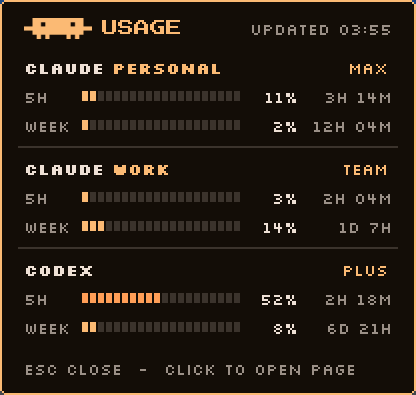

# claude-tracker-hyprpanel

An 8-bit usage menu for [HyprPanel](https://hyprpanel.com) on Hyprland. Click the pixel
mascot on your bar to see how much of your **Claude Code** and **Codex** plan limits you
have used.

<p>
  
  <br>
  
</p>

## Features

- One bar button. Click it to open the menu, and click outside it, press **Esc** or click
  the button again to close it.
- Each account shows its plan and two segmented bars: the **5-hour** window and the
  **weekly** window, with % used and time until reset. Bars turn orange at 50% and red
  at 80%.
- Fresh numbers every time the menu opens. While they load, you see the last known
  numbers dimmed.
- Any number of accounts: several Claude Code logins (for example a personal and a work
  account) plus Codex.
- Colors come from your HyprPanel theme, so the menu matches your bar.
- Clicking an account opens its usage page in your browser.

## Requirements

- Hyprland and HyprPanel
- Python 3.11 or newer, with PyGObject
- GTK 4 and [gtk4-layer-shell](https://github.com/wmww/gtk4-layer-shell)
- Claude Code, logged in with a Claude subscription, and/or the Codex CLI, logged in

On Arch:

```bash
sudo pacman -S gtk4 gtk4-layer-shell python-gobject
```

## Install

```bash
git clone https://github.com/matdomis/claude-tracker-hyprpanel.git
cd claude-tracker-hyprpanel
./install.sh
```

The installer:

- copies `claude-tracker` to `~/.local/bin`, and its images and pixel fonts to `~/.local/share`
- creates `~/.config/claude-tracker/config.toml`, if you don't have one yet
- adds the `custom/claude-tracker` module to HyprPanel's `modules.json` and `modules.scss`

Then do two things by hand:

1. Add `"custom/claude-tracker"` to a bar layout in `~/.config/hyprpanel/config.json`
   (`bar.layouts` → `left`, `middle` or `right`).
2. Restart HyprPanel: `hyprpanel -q; hyprctl dispatch exec hyprpanel`

## Configure

List your accounts in `~/.config/claude-tracker/config.toml`, top to bottom:

```toml
[[account]]
type = "claude"
label = "Claude"
sublabel = "Personal"
config_dir = "~/.claude"          # the folder that holds .credentials.json

[[account]]
type = "claude"
label = "Claude"
sublabel = "Work"
config_dir = "~/.claude-work"     # a second login, started with CLAUDE_CONFIG_DIR

[[account]]
type = "codex"
label = "Codex"
```

See [`config.example.toml`](config.example.toml) for every option.

## How it gets the numbers

- **Claude:** it reads the login token that Claude Code saves in `<config_dir>/.credentials.json`
  and asks Anthropic's OAuth usage endpoint for that account's limits. The token is only
  sent to Anthropic in that request; claude-tracker never stores or copies it.
- **Codex:** it runs `codex app-server` and asks it for the account's rate limits.

Things to know:

- The Claude usage endpoint is not a public API. Anthropic can change it at any time, which
  would break the Claude rows until this tool is updated.
- The endpoint rate-limits when it is called too often. claude-tracker doesn't refetch an
  account that it fetched in the last 30 seconds. If the endpoint still blocks it, the menu
  shows the last numbers with "RATE LIMITED – RETRY IN …".
- Claude login tokens expire after a few hours without use. The menu then says
  "LOGIN EXPIRED – OPEN CLAUDE". Starting `claude` with that account renews the token.

## Uninstall

```bash
./uninstall.sh
```

Then remove `"custom/claude-tracker"` from your bar layout and restart HyprPanel. Your config
in `~/.config/claude-tracker` is kept.

## Credits

- Fonts: [Press Start 2P](https://fonts.google.com/specimen/Press+Start+2P) and
  [Silkscreen](https://fonts.google.com/specimen/Silkscreen), under the SIL Open Font License
  (see `fonts/`).
- The pixel mascot is a fan-made rendering of the Claude Code welcome-screen character.
  This project is not affiliated with or endorsed by Anthropic or OpenAI.

## License

MIT. See [LICENSE](LICENSE).
